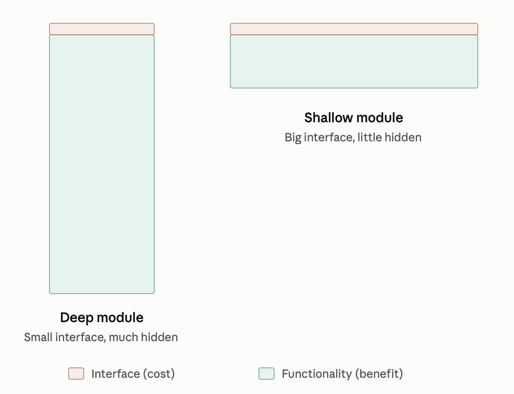

This is architectural concept (coined by [John Ousterhout](john-ousterhout.md) in [The Philosophy of Software Design](the-philosophy-of-software-design.md) book) that pretty much contrasts modules with complex interfaces and simple implementations ([Shallow modules](shallow-modules.md)) to ones with simple interfaces and complex internals ([Deep modules](deep-modules.md)). [Deep modules](deep-modules.md) considered good, [shallow modules](shallow-modules.md) considered bad.

For example, it's easy to misapply saying that wrappers are bad, so decorators etc.

I think this concept is generally unusable (at least by me) due to muddy waters of applicability:

1. **Hard to measure and apply.** Depth is a ratio of hidden knowledge to interface cost, but neither side is measurable, and some depth shows up only over time. `: accrued-interest compound ;` looks shallow until someone changes the `compound` .
2. **Invites mixing cognitive and structural complexity.** “Deep” suggests call-graph depth, while the definition is cognitive. Is the cognitive cost of finding the right word in a FORTH vocabulary a sign of shallowness? Are `>=` and `0=` deeper or shallower than `< 0=` and `0 =`?
3. **Pushes toward bundling.** In practice, chasing depth means merging small functions and adding modes and options to “generalize” interfaces which is **bad** architecture to me.
4. **Ignores value from composition.** Orthogonal libraries (Unix tools, good FORTH vocabularies, `clojure.core`) consist of individually shallow pieces whose value comes from a shared, uniform interface. The framework rewards easy (a small interface per module) and doesn’t price simple unentangled part (see [Rich Hickey](rich-hickey.md)'s  [Simple made Easy](simple-made-easy.md))

## Related

- [Simple made Easy](simple-made-easy.md)
- [The Philosophy of Software Design](the-philosophy-of-software-design.md)
- [Shallow modules](shallow-modules.md)
- [John Ousterhout](john-ousterhout.md)
- [Deep modules](deep-modules.md)

