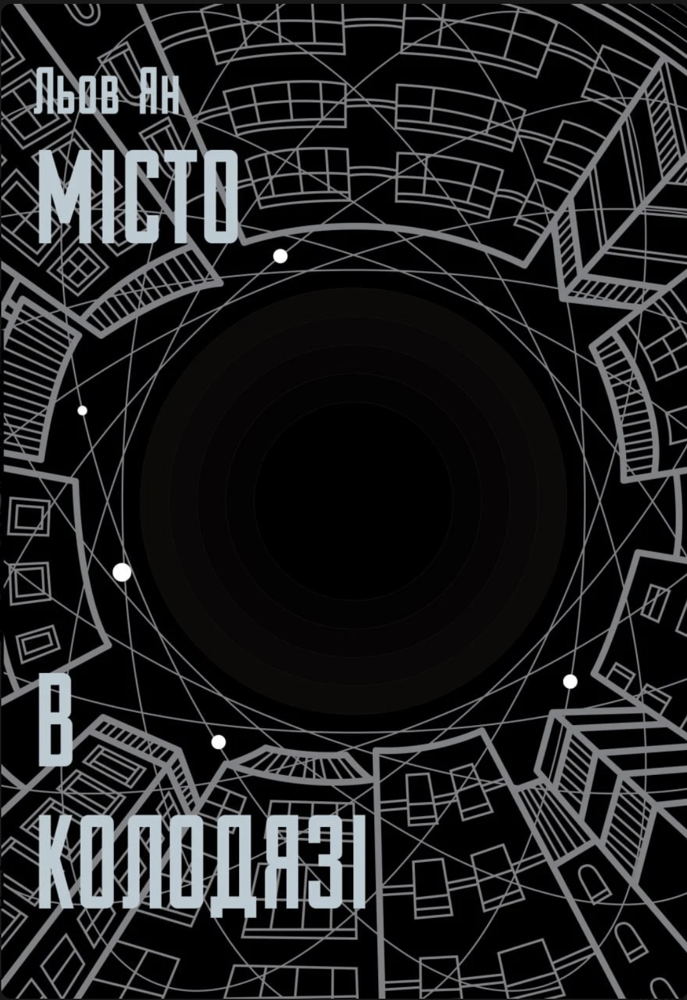

  
I listened to this book in Ukrainian, and it was quite an experience. The biggest one, of course, is the calculated contrast between the slow start of the book and the spiraling finish — where conceptually new ideas just rain down on the reader. It's not bad, but unusual for classic [Sci-fi](scifi.md). Also, the open ending was a bit too open for my liking.

> [!warning]
> spoiler  
> The main character is not a delivery man in a strange futuristic city, but a prodigal scientist who (with the help of aliens, no less) made humanity move to a quantum-based Matrix inside the electrons.

It's fun to read (or even listen to), but it's not a deep book or one you want to re-read. I mean, [Arkady Martine](arkady-martine.md) has written much more enjoyable books with far fewer assumptions. Also I tend to dislike this dry tone of pretty much all Chinese fiction I ever read: from [Three Body Problem](three-body-problem.md) to [Дешифрувати](deshyfruvaty.md)

## Related

- [Arkady Martine](arkady-martine.md)
- [Three Body Problem](three-body-problem.md)
- [Дешифрувати](deshyfruvaty.md)

