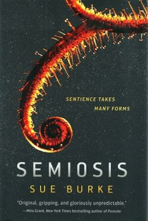

_{\[}_

Nice book, and the translation to Ukrainian is better than I thought from the start.

Plants-human interfaces made possible communication much faster in some extraterrestrial environment which humans try to colonize to diversify from ecological problems of the Earth.

The main idea is similar to [Теплиця](teplytsia.md), which is, alas, a description of anthropocentric or at least animal-centric plant intellect; human-centric even when adding some botanic-specific things such as holding memories in roots and communicating via pollen. But it's a good book, a good book about human society and its evolution.
