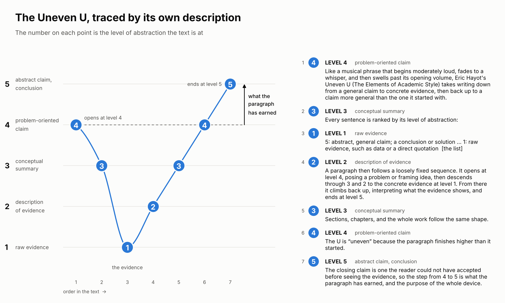

Like a musical phrase that begins moderately loud, fades to a whisper, and then swells past its opening volume, [Eric Hayot](eric-hayot.md)’s Uneven U takes writing down from a general claim to concrete evidence, then back up to a claim more general than the one it started with.

Every sentence is ranked by its level of abstraction:
* **5**: abstract, general claim; a conclusion or solution
* **4**: a claim oriented toward a problem
* **3**: conceptual summary linking pieces of evidence
* **2**: plain description of the evidence
* **1**: raw evidence, such as data or a direct quotation

A paragraph then follows a loosely fixed sequence. It opens at level 4, posing a problem or framing idea, then descends through 3 and 2 to the concrete evidence at level 1. From there it climbs back up, interpreting what the evidence shows, and ends at level 5. Sections, chapters, and the whole work follow the same shape.

The U is “uneven” because the paragraph finishes higher than it started. The closing claim is one the reader could not have accepted before seeing the evidence, so the step from 4 to 5 is what the paragraph has earned, and the purpose of the whole device. It's also similar to [BLUF + recap](bluf-recap.md) and [Tell'em](tell-em-method.md) methods.

## Related

- [Tell'em method](tell-em-method.md)
- [BLUF + recap](bluf-recap.md)
- [Eric Hayot](eric-hayot.md)

